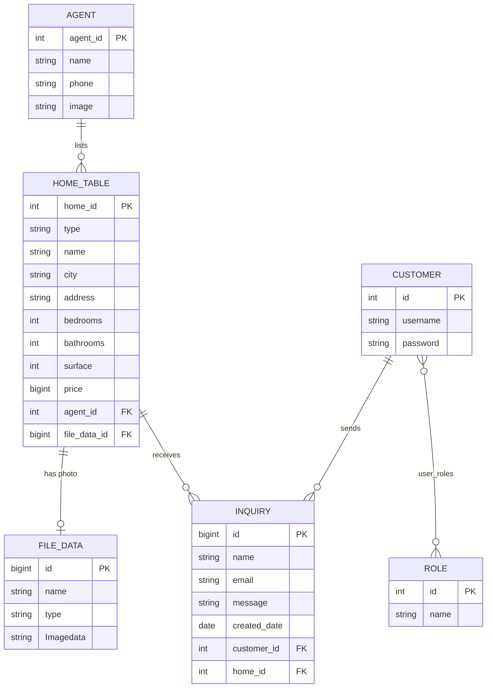

# 🏠 HomeScape Backend

HomeScape is a property-listing platform. Visitors browse homes and filter them by city, type and price, open a home to see its photo, price and agent, and send the agent an inquiry. An admin manages homes, agents, customers and inquiries from a dashboard.

This repository is the backend: a Java **Spring Boot** REST API on **PostgreSQL**, with JWT login. The React frontend is in [HomeScapeFrontend](https://github.com/AaryanBasnet/HomeScapeFrontend).

> **About this project.** HomeScape was built in mid-2024 as an early full-stack project (Java, SQL and React), mostly on my own. It was updated in November 2026: database and token secrets now come from the environment instead of the code, the roles are created at start-up, and this README was written. The [Known limits](#-known-limits) section is honest about what is still weak, security first.

### At a glance

| | |
| --- | --- |
| **10 tables** | Created by Hibernate from the entity classes: homes, agents, customers, roles, inquiries, uploaded files and more |
| **43 endpoints** | 8 controllers: homes, agents, customers, inquiries, about, contact, images, auth |
| **13 automated tests** | JUnit 5 and Mockito unit tests for the home and agent services, plus a Spring context test against PostgreSQL |
| **JWT + BCrypt** | Access token (1 day), refresh token (30 days), passwords stored as BCrypt hashes |
| **~2,400 lines of Java** | 56 files in clear layers: controller, service, repository, entity |

## ✨ How it works

A request travels through four layers, and each one has one job:

```
React (Axios)  ->  Controller  ->  Service  ->  Repository  ->  PostgreSQL
                   URL + JSON      the logic     Spring Data     tables
```

- **Controller:** receives the HTTP request and returns JSON, wrapped in a common `GlobalApiResponse` (`message`, `data`, `statusCode`).
- **Service:** holds the logic (saving a home with its photo, building filters, counting).
- **Repository:** a Spring Data JPA interface. `save`, `findById` and the like need no SQL. Custom queries are written once in JPQL.
- **Entity and Pojo:** an *entity* is the shape of a table row; a *pojo* is the shape of the JSON that goes in and out.

**Filtering** uses one query where each condition can be left out: `(:city IS NULL OR h.city = :city) AND (:type IS NULL OR ...)`, so the frontend sends only the filters the visitor chose.

**Login:** a user registers (password hashed with BCrypt) and logs in. The server returns a signed JWT and a refresh token. The client sends the JWT as `Authorization: Bearer ...`; a filter reads it on each request. `POST /api/auth/refresh` swaps a refresh token for a new access token.

**Photos:** an uploaded photo is saved in a folder on disk (`UPLOAD_DIR`) and its path is stored in the `file_data` table.

## 🗄 Database



Also: `about` and `contact` (the About and Contact pages) and `users` (an older, unused table). `user_roles` is the join table that makes customers and roles many-to-many.

## 🔌 API

All responses are JSON. Home, agent and customer endpoints are wrapped in `GlobalApiResponse`.

| Area | Endpoints |
| --- | --- |
| **Homes** | `GET /home/get` · `GET /home/get/{id}` · `GET /home/filter?city=&propertyType=&minPrice=&maxPrice=` · `GET /home/cities` · `GET /home/properties` · `GET /home/count` · `GET /home/image/{id}` · `POST /home/save` (multipart: `home` JSON + `image`) · `PUT /home/update/{id}` · `DELETE /home/delete/{id}` |
| **Agents** | `GET /agent/get` · `GET /agent/get/{id}` · `POST /agent/save` · `PUT /agent/update/{id}` · `DELETE /agent/delete/{id}` |
| **Customers** | `GET /customer/get` · `GET /customer/get/{id}` · `GET /customer/count` · `POST /customer/save` · `PUT /customer/update/{id}` · `DELETE /customer/delete/{id}` |
| **Inquiries** | `POST /api/inquiry` · `GET /api/inquiry` · `GET /api/inquiry/count` · `GET /api/inquiry/monthly` (counts per month and home, for the dashboard chart) |
| **About, contact** | `/api/about` (CRUD) · `/api/contact` (send, list, count) |
| **Images** | `POST /image/fileSystem` · `GET /image/fileSystem/{name}` · `GET /image/fileSystem` |
| **Auth** | `POST /api/auth/register/user` · `POST /api/auth/register/admin` · `POST /api/auth/login` · `POST /api/auth/refresh` · `POST /api/auth/authenticate` (returns a token only) · `GET /api/auth/secured` (checks a token) |

## 🛠 Tech stack

Java 17 · Spring Boot 3.3 · Spring Web · Spring Security · Spring Data JPA (Hibernate) · PostgreSQL · JJWT · Lombok · Maven · JUnit 5 · Mockito · Docker Compose (for the database)

## ⚙️ Getting started

You need **Java 17** and **Docker** (for PostgreSQL), or your own PostgreSQL server.

```bash
git clone https://github.com/AaryanBasnet/HomeScapeBackend.git
cd HomeScapeBackend

cp .env.example .env          # then choose your own DB_PASSWORD
docker compose up -d          # PostgreSQL on port 5432

# Spring Boot reads settings from the environment (it does not load .env itself),
# so export them (bash shown) or set them in your IDE run configuration:
export DB_PASSWORD=choose-a-password
export JWT_SECRET=a-long-random-string-of-at-least-32-characters

./mvnw spring-boot:run        # http://localhost:8080
```

Hibernate creates the tables on the first start, and the `USER` and `ADMIN` roles are created automatically.

### Environment variables

| Variable | Needed | What it is |
| --- | --- | --- |
| `DB_PASSWORD` | yes | Password of the PostgreSQL user |
| `DB_URL` | no | Default `jdbc:postgresql://localhost:5432/homescapedb` |
| `DB_USERNAME` | no | Default `postgres` |
| `JWT_SECRET` | recommended | At least 32 characters. Without it a random key is used, so everyone is logged out whenever the server restarts |
| `ADMIN_USERNAME`, `ADMIN_PASSWORD` | no | Set both and a first admin account is created at start-up. Leave them empty and none is created |
| `UPLOAD_DIR` | no | Folder for uploaded photos, default `uploads/` (created if missing) |
| `SERVER_PORT` | no | Default `8080` |

The frontend expects the API at `http://localhost:8080` unless you set `VITE_API_BASE_URL` there.

## 🧪 Testing

```bash
./mvnw test
```

13 tests: 6 for the home service and 6 for the agent service (Mockito mocks, no database), and 1 Spring context test that starts the whole application, so it needs PostgreSQL and the environment variables above.

## 📁 Project structure

```
src/main/java/com/example/homescapebackend/
  controller/   HTTP endpoints (8 controllers)
  service/      the logic; service/impl has the implementations and photo storage
  repo/         Spring Data JPA repositories
  entity/       table classes (Home, Agent, Customer, Role, Inquiry, FileData, ...)
  pojo/         request and response shapes
  security/     JWT filter and generator, Spring Security configuration
  shared/       GlobalApiResponse
src/main/resources/application.properties   settings, all secrets read from the environment
src/test/                                   JUnit and Mockito tests
docker-compose.yml                          PostgreSQL for local development
```

## 🚧 Known limits

Be careful before putting this online as it is. These were found by running it and reading the code:

- **The API does not enforce who may do what.** Every endpoint is open (`permitAll`), so with no login anyone can call `POST /api/auth/register/admin` to create an admin, or `GET /customer/get`, which returns every customer including their password hashes. The roles exist and are saved at login, but only the frontend uses them to hide screens. The fix: require a valid token for everything except login, register and the public home reads, check `hasRole("ADMIN")` on the admin routes, and remove open admin registration.
- **Earlier versions had credentials in the code** (a database password and a default admin account). They are now read from the environment, but they remain in the Git history of this public repository. Treat anything that was ever used as exposed and change it.
- **Photos are stored on the server's disk,** so they are lost when a container or server is replaced. A database column or object storage such as S3 would fix that.
- **The schema is created with `ddl-auto=update`,** not with migrations (Flyway or Liquibase).
- **Little input validation,** and the tests cover only two services.
- The frontend runs against `localhost:8080` by default, and the app has not been deployed.

## 📬 Author

Aaryan Basnet · [GitHub](https://github.com/AaryanBasnet) · [LinkedIn](https://www.linkedin.com/in/aaryan-basnet)
